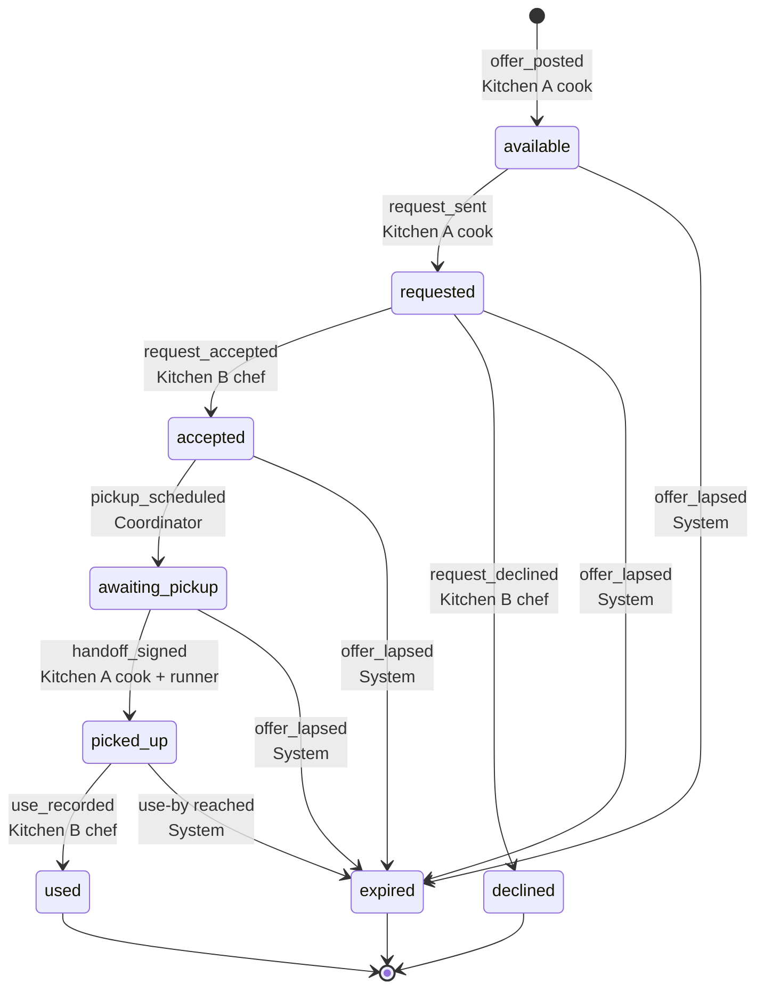

# Second Serve transfer flow

One transfer moves one ingredient from the kitchen that has extra (Kitchen A) to a kitchen that has a menu item needing it (Kitchen B). Kitchen A sends the transfer offer. Kitchen B accepts or declines it. This doc is the contract for that flow. The types are in `app/src/data/scenario.ts`. The worked sample is `app/public/data/scenario-spinach.json`, and the demo walkthrough is `docs/demo-script.md`.

The sample is fictional. People, quantities, times and temperature readings are made up. Menu items, food-safety thresholds and Eatec terms come from the sources at the end.

## The sample scenario

This is the pitch deck's fictional scenario (`docs/deck/README.md`, slides 2 and 3). Every number on screen comes from the fixture.

| Fact | Value | Fixture field |
|---|---|---|
| Today | Wednesday, day 0. Thursday is day 1 and Friday is day 2 | `today_weekday`, `time_basis` |
| Kitchen A | Crossroads · Dining hall | `kitchens.a` |
| Kitchen B | Café 3 · Campus cafe | `kitchens.b` |
| On hand at Kitchen A | 10 lb spinach | `lot.on_hand_lb` |
| Allocated | 6 lb to Thursday's lunch menu, Baby Spinach at the Salad Bar | `lot.allocated` |
| Unallocated and offered | 4 lb, best by Friday | `lot.available_lb`, `lot.use_by` |
| Kitchen B's use | Nancy Silverton's Sauteed Spinach with Lemon & Garlic, Thursday lunch | `demand` |
| Source line | "Eatec export, today 06:00", read Wednesday before the offer is sent | `lot.source_label` |
| Banner | "Fictional scenario · Sample data only" | `banner_label` |
| Planned, Reported, Verified at the end of the happy path | 4 lb each, never summed | `paths[happy]` |

## Stages

The walkthrough groups its six steps under the deck's three stages. `STAGES` in `app/src/walkthrough/steps.ts` holds the copy.

| Stage | Deck subtitle | Steps | Events |
|---|---|---|---|
| 01 Review availability | Confirm what is unallocated and still usable | 1 Mark the extra | inventory_imported, offer_posted |
| 02 Request a transfer | Kitchen B reviews the quantity and timing | 2 Send the offer, 3 Accept or decline | request_sent, request_accepted or request_declined |
| 03 Agree on the handoff | Identify who approves and coordinates pickup | 4 Set the pickup, then 5 Hand off and use and 6 Verify, labelled "Simulated follow-through" | pickup_scheduled, handoff_signed, receipt_checked, use_recorded, records_imported |

An offer that lapses closes during stage 02, before anyone agrees on a handoff. Steps 5 and 6 are flagged `simulated` in `steps.ts`. The Eatec import that sets Verified shows as "Simulated next-morning Eatec export (sample)".

## Roles

| Role | In the sample | Can do | Cannot do |
|---|---|---|---|
| Kitchen A cook | Crossroads cook | Mark extra food, send a transfer offer to a kitchen with a matching menu item, sign the handoff, note what happens after an offer lapses | Accept its own offer, set verified |
| Kitchen B chef | Café 3 chef | Accept or decline the offer, check the food in, record use | Send an offer for food it does not hold, set verified |
| Coordinator | Cal Dining operations, one named person per shift | Set the pickup window, runner and carrier | Accept, decline, record use, set verified |
| System | Second Serve | Read Eatec exports, close lapsed offers, set the verified outcome | Change any person's entry |

The coordinator is a role, not a new hire. Our notes from the Cal Zero Waste interview on 2026-10-12 record two points. More data means more work unless someone cleans and reads it. Berkeley also has no dedicated waste-data analyst. These are our paraphrases, not direct quotes. So the coordinator only schedules, and checking is automatic.

## States

| State | Means | UI label |
|---|---|---|
| available | Kitchen A has marked food it will not use before the use-by date | Extra |
| requested | Kitchen A has sent a transfer offer to Kitchen B for a named menu item | Offer sent |
| accepted | Kitchen B said yes. No pickup set yet | Accepted |
| declined | Kitchen B said no. Kitchen A can offer the food to another kitchen | Declined |
| awaiting_pickup | Pickup window and runner are set | Pickup set |
| picked_up | Handoff signed. The food has left Kitchen A | Picked up |
| used | Kitchen B reports it went into the menu item | Used |
| expired | The offer, needed-by time or use-by date passed first | Offer closed |

**Show `expired` as "Offer closed".** Kitchen staff read "expired" as "thrown out." Most lapsed offers are still good food that Kitchen A will use itself. Reserve the word "expired" for food past its use-by date.

Extra food and a transfer are different things. Kitchen A can send offers for the same extra food to several kitchens. Each offer sent is its own transfer with its own state. A decline ends that transfer. The food stays available.

## Transitions

Every row writes one entry to the append-only activity log. Each entry has a sequence number, time, actor role, person, from and to states, the fields below, and one plain sentence. Nobody can edit or delete an entry. Corrections are new entries.

| Event | From → to | Actor | Required fields | Also logged |
|---|---|---|---|---|
| inventory_imported | none | System | lot id, on-hand lb, export time | The Eatec export as the provenance line, such as "Eatec export, today 06:00" |
| offer_posted | (new) → available | Kitchen A cook | lot id, qty lb extra, use-by date, storage and temperature constraint | Walk-in temperature reading |
| request_sent | available → requested | Kitchen A cook | Kitchen B, qty lb, intended use as a menu item from Kitchen B's menu, needed-by time, offer-until time, storage constraint | Who sent it, and which menu match suggested Kitchen B |
| request_accepted | requested → accepted | Kitchen B chef | qty lb confirmed, needed-by confirmed | Sets **planned_action** |
| request_declined | requested → declined | Kitchen B chef | reason: already stocked, can't make the time, no cold storage, quality concern, or other with a note | The food stays available to offer elsewhere |
| pickup_scheduled | accepted → awaiting_pickup | Coordinator | pickup window, runner, carrier | |
| handoff_signed | awaiting_pickup → picked_up | Kitchen A cook, countersigned by the runner | weighed qty lb, temperature at handoff, both signatures | Sets **completed_action** kind `transferred` |
| receipt_checked | picked_up → picked_up | Kitchen B chef | weighed qty lb, temperature at receipt, where stored | A reading above 41°F means refuse it and log why |
| use_recorded | picked_up → used | Kitchen B chef | qty lb used, menu item | Sets **completed_action** kind `used` |
| offer_lapsed | any open state → expired | System | reason: offer window closed, needed-by passed, or use-by reached | The text "Nothing was thrown out by this event" |
| records_imported | no change | System | the Eatec record it matched | May set **verified_outcome** |
| disposition_noted | expired → expired | Kitchen A cook | use first here, donate, compost or landfill | Informational. It is not a transfer |

The system closes an open transfer at the earliest of these three times:

- the offer-until time, while the transfer is `available` or `requested`, so Kitchen B did not answer in time
- the needed-by time, while it is `accepted` or `awaiting_pickup`
- the use-by date, in any open state

An offer whose needed-by time falls after the lot's use-by date cannot be sent. The form blocks it.

## Planned, completed, verified

The advisor's main point was to keep these three apart. The app must never add them together or show one as another.

| Tier | Means | Set only by | Never set by |
|---|---|---|---|
| **planned_action** | Both kitchens agreed to move a stated qty for a stated menu item by a stated time | `request_accepted` by Kitchen B | Marking food extra, sending an offer, or a system suggestion |
| **completed_action** | A person in Second Serve says it happened. Kind `transferred` after the handoff. Kind `used` after use | `handoff_signed` and `use_recorded` | Any system event |
| **verified_outcome** | Records outside Second Serve agree with what people reported | `records_imported`, which is a System event | **Any click, by anyone, including the coordinator** |

Verification runs three checks against the next Eatec exports:

1. **transfer_posted.** An Eatec transfer exists from Kitchen A to Kitchen B for this ingredient, posted on the handoff day, with qty within 0.25 lb.
2. **production_recorded.** Kitchen B's production record shows the menu item made on the planned day, and its on-hand stock for the ingredient fell by about the transferred qty.
3. **no_waste_entry.** There is no waste entry for this lot at either kitchen through the end of the day of use.

All three must match before the outcome is `verified`. Any mismatch makes it `mismatch`, and the coordinator sees it. Until the exports arrive, the outcome is `pending`.

The rule for numbers on screen follows from this. Pounds saved count only verified outcomes. Planned and completed pounds show in their own columns, labelled "Planned" and "Reported."

Verification does not prove a person watched the spinach go into the pan. It proves that two independent records, the inventory transfer and the production record, agree with the self-report.

## Temperature constraint

Raw spinach leaves count as cut leafy greens, a potentially hazardous food. Berkeley EH&S names spinach in that class.

| Rule | Value | Source |
|---|---|---|
| Cold holding | 41°F or colder | CalCode §113996(a), EH&S |
| Held during transport | 45°F or colder | CalCode §113996(c) |
| Short trip to or from a facility | Under 30 minutes is excepted from (a) | CalCode §113996(a) |
| Second Serve receiving rule | Refuse above 41°F at receipt | Our rule, stricter than code |
| Shelf life used for use-by | 3 to 7 days refrigerated. The sample uses the midpoint, 5 days, so spinach received Sunday is best by Friday | USDA FoodKeeper |

Time as a Public Health Control, the 4-hour rule, covers food being prepped or held for service. It does not cover carrying food between kitchens, so the flow relies on temperature, not time. That is our reading of the sources, not a ruling. Confirm it with Berkeley EH&S before a real pilot.

## Vocabulary

None of our interviews so far are with Cal Dining kitchen staff. The kitchen words below come from Eatec, which Cal Dining's own menu exports use, and from BYU Dining's public Eatec procedures. Treat every row marked "confirm" as a guess until a Cal Dining chef says it. Cal Zero Waste pointed us to Shannen Casey in Housing & Dining.

| Our term | Staff term | Source | Status |
|---|---|---|---|
| Kitchen A | From Location, or Supply Location | BYU Eatec Transfers SOP, Requisitions SOP | confirm |
| Kitchen B | To Location, or Requesting Location | same | confirm |
| transfer offer, sent by Kitchen A | transfer without a requisition, started by the From Location | BYU Eatec Transfers SOP | confirm |
| Kitchen B asking first | requisition | BYU Eatec Requisitions SOP: "requisitions are the precursor to transfers" | not used, see open question |
| completed transfer | transfer, with a Post Date that "cannot be in the future" | BYU Eatec Transfers SOP | confirm |
| handoff signature | "paper trail with signatures… as proof of physical delivery" | BYU Eatec Transfers SOP | confirm |
| lot | lot, for lot-tracked items | BYU Eatec Transfers SOP | confirm |
| used | produced, the production record | BYU Eatec Transfers SOP, which points to the Production SOP | confirm |
| available | extra, surplus, or "not on the prep sheet". UI label "Extra" | None yet | **ask** |
| expired, for an offer | "Offer closed" in the UI | Our choice, to avoid "expired = toss" | **ask** |
| potentially hazardous food | PHF, or TCS food | CalCode §113871 and §113996, Berkeley EH&S | sourced |
| waste reason | loss reason, waste reason, disposition code | EPA food waste log (LeanPath), Leanpath | sourced |
| verified | — | Our term. Staff have no word for it yet | **ask** |
| donate | Grab n Go, prepared food from campus dining | Basic Needs Food Pantry FAQ | sourced |
| pickup request, dispatch | "request pickups", "log donation volume and dispatch" | Copia | sourced |

## Open question: who starts the transfer

The demo has Kitchen A send the offer and Kitchen B accept, following the advisor's written feedback. Eatec's own convention runs the other way. The kitchen with the need raises a requisition, and the supplying kitchen fills it with a transfer. Eatec also allows a transfer without a requisition, started by the From Location, which is what the demo shows. Confirm the direction with Cal Dining kitchen staff during the pilot. If they work from requisitions, swap who sends and who accepts. The states do not change.

## Out of scope for the demo

- **Donation as a destination.** The Basic Needs Food Pantry gets prepared food from Berkeley Dining for Grab n Go. It publishes no intake steps for raw produce. `disposition_noted: donate` is a note only until the pantry, at foodpantry@berkeley.edu, confirms a process.
- **Splitting extra food across several offers.** The types allow it, but the sample sends one offer for the whole 4 lb.
- **Kitchen A withdrawing a sent offer.** Not modelled. Kitchen A asks Kitchen B to decline.
- **The generator's `Transfer.status`.** `proposed` maps to `available` and `completed` maps to `picked_up`. The generator has no request, accept or verify steps. Its `est_lb_saved` is a planned number, not a verified one.

## Sources

- CalCode §113996, holding temperatures: https://california.public.law/codes/ca_health_and_safety_code_section_113996
- CalCode §113871, potentially hazardous food: https://california.public.law/codes/ca_health_and_safety_code_section_113871
- UC Berkeley EH&S, Time as a Public Health Control, which lists spinach as a cut leafy green PHF: https://ehs.berkeley.edu/sites/default/files/time_as_a_public_health_control.pdf
- USDA FSIS FoodKeeper, fresh spinach refrigerated 3 to 7 days: https://catalog.data.gov/dataset/fsis-foodkeeper-data, row in `data/raw/reference/shelf_life.csv`
- BYU Dining Services SOP BP0018, Transfers in Eatec: https://dining.byu.edu/eatec/transfers
- BYU Dining Services SOP, Requisitions in Eatec: https://dining.byu.edu/eatec/requisitions
- UC Berkeley Basic Needs, Food Pantry FAQ: https://basicneeds.berkeley.edu/faq/food-pantry
- EPA food waste log, crediting LeanPath, with a Loss Reason column: https://archive.epa.gov/wastes/conserve/pubs/web/pdf/food-waste-log.pdf
- Leanpath, food type, waste reason and disposition code: https://cec.org/files/pdf/fww/wb-presentations/8-andrew-shakman.pdf
- Copia, pickup requests and dispatch: https://practicegreenhealth.org/sites/default/files/2020-03/Copia%20COVID-19%20food%20insecurity%20response%20flyer.pdf
- Café 3 menu item, Nancy Silverton's Sauteed Spinach with Lemon & Garlic, Pasta station, lunch: https://dining.berkeley.edu/wp-content/uploads/menus-exportimport/Cafe_3_20261026.xml
- Crossroads menu item, Baby Spinach, Salad Bar, lunch: https://dining.berkeley.edu/wp-content/uploads/menus-exportimport/Crossroads_20261027.xml
- Cal Zero Waste interview with Sam Bunke and Lin King, 2026-10-12. These are private notes, not public. Quote them only with permission.
